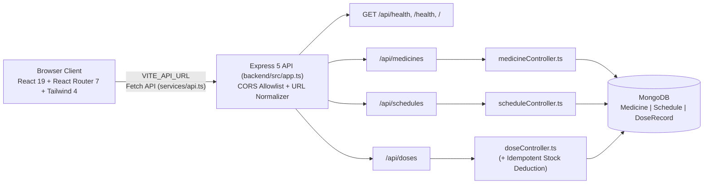

# Medicine-Reminder-Stock-Tracker


-blue?style=flat-square)

> Full-stack TypeScript web application for managing medication schedules, tracking daily doses, monitoring low-stock thresholds, and automatically deducting inventory when doses are marked as taken.

---

## Table of Contents

- [Project Introduction](#project-introduction)
- [Problem Statement](#problem-statement)
- [Project Objectives](#project-objectives)
- [Key Features](#key-features)
- [Technology Stack](#technology-stack)
- [Screenshots](#screenshots)
- [Architecture Diagram](#architecture-diagram)
- [Application Workflow](#application-workflow)
- [Project Directory Structure](#project-directory-structure)
- [Database Design](#database-design)
- [API Documentation](#api-documentation)
- [Installation Instructions](#installation-instructions)
- [Environment Variables](#environment-variables)
- [How to Run Locally](#how-to-run-locally)
- [Usage Examples & Real-World Scenarios](#usage-examples--real-world-scenarios)
- [Testing Instructions & Results](#testing-instructions--results)
- [Deployment Instructions](#deployment-instructions)
- [Security Considerations](#security-considerations)
- [Future Improvements](#future-improvements)
- [Contribution Guidelines](#contribution-guidelines)
- [License](#license)
- [Author](#author)

---

## Project Introduction

**Medicine-Reminder-Stock-Tracker** combines a RESTful Express 5 + Mongoose backend with a responsive React 19 + Tailwind CSS 4 single-page application. Patients and caregivers can maintain a medicine inventory, define recurring dosage schedules, record daily adherence (`pending`, `taken`, `missed`), review adherence history, and receive automated inventory updates whenever a scheduled dose is confirmed taken.

---

## Problem Statement

Managing multiple prescriptions manually introduces two recurring failure modes:

1. **Missed or Duplicated Doses:** Without a centralized daily schedule and timestamped log (`takenAt`), patients lose track of whether a morning or evening dose was already administered.
2. **Unexpected Stockouts:** Paper notes or standalone alarm apps do not decrement pill counts when doses are logged, leaving patients unaware that stock has fallen below their refill threshold until a bottle is empty.

---

## Project Objectives

- Provide full CRUD management for medications (`Medicine`), dosage schedules (`Schedule`), and daily dose records (`DoseRecord`) persisted in MongoDB.
- Enforce idempotent stock deduction inside the API controller so marking a dose `taken` decrements `currentStock` once (floored at `0`) and timestamps `takenAt`.
- Support timezone-tolerant `/api/doses/today` lookups bridging local and UTC day boundaries.
- Deliver clean SPA navigation across dashboard summaries, medicine management, schedule creation, today's doses, and historical adherence logs using typed frontend API clients.

---

## Key Features

- **Medication Inventory Management:** Create, view, edit, and delete medicines with dosage, frequency, schedule time, date range (`startDate`/`endDate`), `initialStock`, `currentStock`, `lowStockThreshold` (default `5`), and optional notes.
- **Automated Idempotent Stock Deduction:** Updating a `DoseRecord` status to `"taken"` via `PUT /api/doses/:id` automatically records `takenAt` and deducts `1` from the linked medicine's `currentStock` (only when transitioning from a non-`taken` status, never dropping below `0`).
- **Recurring Schedules:** Link enabled/disabled `Schedule` entries to any medicine (`GET /api/schedules?medicineId=...`).
- **Today's Dose Tracking (`GET /api/doses/today`):** Computes an inclusive date window covering both local and UTC day boundaries, filterable by optional `?date` and `?medicineId`.
- **Adherence History Filtering (`GET /api/doses`):** Filter dose logs by `medicineId`, `scheduleId`, and `status` (`pending`, `taken`, `missed`).
- **7-Page React SPA:** Dedicated views for Dashboard (`/dashboard`), Medicines List (`/medicines`), Add/Edit Medicine (`/medicines/new`, `/medicines/:id/edit`), Medicine Detail (`/medicines/:id`), Schedules (`/schedules`), Doses (`/doses`), and History (`/history`), with toast feedback, empty states, loading spinners, and modal dialogs.
- **Deployment Ready:** Includes `render.yaml` for backend deployment on Render and `frontend/vercel.json` SPA rewrites for Vercel hosting.

---

## Technology Stack

### Backend (`backend/package.json`)

| Package | Version | Purpose |
| --- | --- | --- |
| Express | `^5.1.0` | HTTP server, routing, slash/prefix normalization, error handling |
| Mongoose | `^8.24.4` | MongoDB schemas, validation, `.populate()` relations |
| TypeScript | `^5.9.3` | Strict backend typing compiled to `dist/` |
| `cors` | `^2.8.5` | Dynamic allowlist (`localhost`, `*.vercel.app`, `CLIENT_URL`) |
| `dotenv` | `^17.2.3` | Loads `backend/.env` before server startup |
| `tsx` | `^4.23.15` | Watch-mode TypeScript runner (`npm run dev`) |

### Frontend (`frontend/package.json`)

| Package | Version | Purpose |
| --- | --- | --- |
| React / React DOM | `^19.2.8` | Component UI library |
| React Router DOM | `^7.18.4` | Client-side routing (`/dashboard`, `/medicines`, `/schedules`, `/doses`, `/history`) |
| Vite | `^8.3.0` | Frontend bundler and dev server (`@vitejs/plugin-react`) |
| Tailwind CSS | `^4.3.3` | Utility-first styling via `@tailwindcss/vite` |
| Lucide React | `^1.52.0` | UI icon set |
| TypeScript / `oxlint` | `~6.0.2` / `^1.81.0` | Type checking (`tsc -b`) and linting |

---

## Screenshots

No UI screenshots are currently committed to this repository. Running the frontend (`npm run dev` in `frontend/`) renders the 7 routed pages (`DashboardPage`, `MedicinesListPage`, `MedicineFormPage`, `MedicineDetailPage`, `SchedulesPage`, `DosesPage`, and `HistoryPage`).

---

## Architecture Diagram



---

## Application Workflow

1. **Medicine Creation:** The user submits a medicine via `MedicineFormPage` (`POST /api/medicines`) with starting inventory (`initialStock`, `currentStock`) and a `lowStockThreshold`.
2. **Schedule Setup:** Schedules are created on `SchedulesPage` (`POST /api/schedules`) referencing `medicineId`, reminder `time`, `frequency`, and `enabled` flag.
3. **Daily Dose Management:** `DosesPage` queries `/api/doses/today` and allows creating or updating daily `DoseRecord` items.
4. **Stock Synchronization:** Marking a dose `"taken"` triggers `updateDose` (`PUT /api/doses/:id`), which auto-populates `takenAt` (if absent) and reduces the medicine's `currentStock` by `1` without going below `0` — guarded so repeated `"taken"` updates do not double-deduct stock.
5. **Monitoring & History:** `DashboardPage` highlights active schedules and low-stock medicines (`currentStock <= lowStockThreshold`), while `HistoryPage` displays filterable adherence records across dates and statuses.

---

## Project Directory Structure

Tracked structure in the repository (`git ls-files`):

```text
Medicine-Reminder-Stock-Tracker/
├── .gitignore                        # Root ignore rules
├── README.md                         # Project documentation
├── render.yaml                       # Render backend deployment spec (PORT=10000, rootDir: backend)
├── backend/
│   ├── .env.example                  # Sample backend env config (PORT, MONGODB_URI, CLIENT_URL)
│   ├── .gitignore
│   ├── package.json                  # Express 5, Mongoose 8, TypeScript, tsx
│   ├── tsconfig.json
│   └── src/
│       ├── server.ts                 # Env loader, PORT validation, 0.0.0.0 bind, DB connect
│       ├── app.ts                    # CORS allowlist, path normalization, route mounting, 404/error handlers
│       ├── config/database.ts        # Mongoose connection helper
│       ├── models/
│       │   ├── Medicine.ts           # Inventory & threshold schema
│       │   ├── Schedule.ts           # Reminder time & enabled state schema
│       │   └── DoseRecord.ts         # Dose log (pending | taken | missed) schema
│       ├── controllers/
│       │   ├── medicineController.ts
│       │   ├── scheduleController.ts
│       │   └── doseController.ts     # Filtering, local+UTC today window, stock deduction
│       └── routes/
│           ├── medicineRoutes.ts
│           ├── scheduleRoutes.ts
│           └── doseRoutes.ts
└── frontend/
    ├── .env.example                  # VITE_API_URL=http://localhost:5000/api
    ├── .oxlintrc.json                # oxlint ruleset
    ├── vercel.json                   # Vercel SPA rewrite to /
    ├── package.json                  # React 19, Vite 8, Tailwind 4, oxlint
    ├── vite.config.ts
    └── src/
        ├── App.tsx                   # BrowserRouter routes (/dashboard, /medicines/*, /schedules, /doses, /history)
        ├── context/ToastContext.tsx
        ├── services/api.ts           # Typed fetch wrapper (medicinesApi, schedulesApi, dosesApi)
        ├── types/index.ts
        ├── components/
        │   ├── common/               # Badge, Button, EmptyState, ErrorState, LoadingSpinner, Modal
        │   └── layout/               # Layout, Navbar, Sidebar
        └── pages/                    # Dashboard, MedicinesList, MedicineForm, MedicineDetail, Schedules, Doses, History
```

---

## Database Design

Three MongoDB collections modeled with Mongoose (`{ timestamps: true }`):

### 1. `Medicine` (`backend/src/models/Medicine.ts`)

| Field | Type | Constraints / Default | Purpose |
| --- | --- | --- | --- |
| `name` | `String` | `required`, `trim` | Medication display name |
| `dosage` | `String` | `required`, `trim` | Strength/dose (e.g., `500mg`) |
| `frequency` | `String` | `required`, `trim` | Dosing cadence |
| `scheduleTime` | `String` | `required`, `trim` | Primary reminder time |
| `startDate` / `endDate` | `Date` | `startDate` required, `endDate` optional | Active course dates |
| `initialStock` / `currentStock` | `Number` | `required`, `min: 0` | Baseline and remaining pill/unit counts |
| `lowStockThreshold` | `Number` | Default: `5`, `min: 0` | Threshold for low-stock warning UI |
| `notes` | `String` | Default: `""`, `trim` | Optional instructions |

### 2. `Schedule` (`backend/src/models/Schedule.ts`)

| Field | Type | Constraints / Default | Purpose |
| --- | --- | --- | --- |
| `medicineId` | `ObjectId` | `ref: "Medicine"`, `required` | Parent medicine reference |
| `time` | `String` | `required`, `trim` | Reminder time |
| `frequency` | `String` | `required`, `trim` | Schedule frequency |
| `startDate` / `endDate` | `Date` | `startDate` required, `endDate` optional | Schedule validity range |
| `enabled` | `Boolean` | Default: `true` | Active toggle |

### 3. `DoseRecord` (`backend/src/models/DoseRecord.ts`)

| Field | Type | Constraints / Default | Purpose |
| --- | --- | --- | --- |
| `medicineId` | `ObjectId` | `ref: "Medicine"`, `required` | Medicine taken/scheduled |
| `scheduleId` | `ObjectId` | `ref: "Schedule"`, optional | Linked schedule entry |
| `scheduledDate` | `Date` | `required` | Calendar date of scheduled dose |
| `scheduledTime` | `String` | `required`, `trim` | Scheduled dose time |
| `status` | `String` | Enum `["pending", "taken", "missed"]`, default `"pending"` | Adherence outcome |
| `takenAt` | `Date` | Optional (auto-managed on status change) | Timestamp when marked `"taken"` |
| `notes` | `String` | Default: `""`, `trim` | Optional intake note |

---

## API Documentation

Base URL (local): `http://localhost:5000/api` (middleware in `app.ts` also normalizes duplicate slashes and prefixes non-`/api` paths automatically).

### Health Endpoint

| Method | Endpoint | Response |
| --- | --- | --- |
| `GET` | `/api/health` (or `/health`, `/`) | `200 OK` `{ "success": true, "message": "Medicine Reminder API is running" }` |

### Medicines (`/api/medicines`)

| Method | Endpoint | Description |
| --- | --- | --- |
| `POST` | `/api/medicines` | Create a new medicine with stock counts & threshold |
| `GET` | `/api/medicines` | List all medicines sorted newest-first (`createdAt: -1`) |
| `GET` | `/api/medicines/:id` | Fetch single medicine by ObjectId |
| `PUT` | `/api/medicines/:id` | Update medicine attributes and stock counts |
| `DELETE` | `/api/medicines/:id` | Delete medicine record |

### Schedules (`/api/schedules`)

| Method | Endpoint | Description |
| --- | --- | --- |
| `POST` | `/api/schedules` | Create a schedule linked to `medicineId` |
| `GET` | `/api/schedules` | List schedules (supports `?medicineId=<id>`) |
| `GET` | `/api/schedules/:id` | Fetch single schedule by ObjectId |
| `PUT` | `/api/schedules/:id` | Update schedule timing, frequency, dates, or `enabled` state |
| `DELETE` | `/api/schedules/:id` | Delete schedule entry |

### Dose Records (`/api/doses`)

| Method | Endpoint | Description |
| --- | --- | --- |
| `POST` | `/api/doses` | Create a dose log (`pending`, `taken`, or `missed`) |
| `GET` | `/api/doses` | List doses (filters: `?medicineId`, `?scheduleId`, `?status`) |
| `GET` | `/api/doses/today` | Fetch today's doses across local+UTC boundary window (optional `?date`, `?medicineId`) |
| `GET` | `/api/doses/:id` | Fetch single dose populated with `medicineId` and `scheduleId` |
| `PUT` | `/api/doses/:id` | Update status/notes; deducts stock (`-1`, min `0`) once upon transition to `"taken"` |
| `DELETE` | `/api/doses/:id` | Delete dose record |

---

## Installation Instructions

### Prerequisites

- **Node.js** `v18+` (or `v20+` LTS) and **npm**
- **MongoDB** (local daemon or MongoDB Atlas cluster)

### Clone & Install

```bash
git clone https://github.com/mohan5535/Medicine-Reminder-Stock-Tracker.git
cd Medicine-Reminder-Stock-Tracker

# Backend dependencies
cd backend
npm install
cp .env.example .env

# Frontend dependencies
cd ../frontend
npm install
cp .env.example .env
```

---

## Environment Variables

### Backend (`backend/.env` — template in `backend/.env.example`)

| Variable | Default / Example | Purpose |
| --- | --- | --- |
| `PORT` | `5000` (Render uses `10000`) | HTTP listen port (`0–65535` integer validated at startup) |
| `MONGODB_URI` | `mongodb+srv://...` | Required MongoDB connection string |
| `CLIENT_URL` | `http://localhost:5173` | Comma-separated allowed frontend CORS origins |

### Frontend (`frontend/.env` — template in `frontend/.env.example`)

| Variable | Default / Example | Purpose |
| --- | --- | --- |
| `VITE_API_URL` | `http://localhost:5000/api` | Base URL consumed by `frontend/src/services/api.ts` |

---

## How to Run Locally

Open two terminals from the repository root:

```bash
# Terminal 1 — Start Backend API (port 5000)
cd backend
npm run dev
```

```bash
# Terminal 2 — Start Frontend SPA (Vite default port 5173)
cd frontend
npm run dev
```

Verify API health at `http://localhost:5000/api/health` and open `http://localhost:5173` in a browser. Live frontend deployment URL configured in GitHub & CORS allowlists: `https://medicine-reminder-stock-tracker-fro.vercel.app`.

---

## Usage Examples & Real-World Scenarios

### Scenario 1: Setting Up a Daily Prescription & Refill Alert Threshold

A patient or caregiver registers a twice-daily prescription with 30 starting tablets and a low-stock threshold of 5 (`POST /api/medicines`), then attaches recurring morning/evening reminders (`POST /api/schedules`):

```bash
# 1. Create a medicine with stock tracking
curl -X POST http://localhost:5000/api/medicines \
  -H "Content-Type: application/json" \
  -d '{
    "name":"Metformin",
    "dosage":"500mg",
    "frequency":"Once daily",
    "scheduleTime":"08:00",
    "startDate":"2026-11-12",
    "initialStock":30,
    "currentStock":30,
    "lowStockThreshold":5,
    "notes":"Take after breakfast"
  }'

# 2. Fetch today'\''s scheduled doses across local/UTC boundary
curl http://localhost:5000/api/doses/today
```

### Scenario 2: Marking a Dose Taken With Idempotent Inventory Deduction

When the patient clicks **Mark Taken** on `DosesPage` (`PUT /api/doses/:id` with `{ "status": "taken" }`), `doseController.ts` sets `takenAt` automatically and reduces `currentStock` by `1` (floored at `0`) **once** — preventing double deduction if the update is retried. Once `currentStock <= lowStockThreshold`, `DashboardPage` highlights a low-stock refill warning.

---

## Testing Instructions & Results

- **Current Automated Coverage:**
  - `backend/package.json` provides `dev`, `build` (`tsc`), and `start` scripts; there is **no automated backend test runner or suite** configured yet.
  - `frontend/package.json` provides **TypeScript project build verification** (`npm run build` executes `tsc -b && vite build`) and **linting** (`npm run lint` executes `oxlint`), with no automated unit/E2E test runner configured.
- **Verification Commands Available Locally:**

```bash
# Backend TypeScript compilation check
cd backend && npm run build

# Frontend linter and TypeScript + Vite build check
cd frontend && npm run lint && npm run build
```

- **Note on Results:** No fabricated test pass metrics are reported here; run the build/lint commands above alongside manual CRUD verification against a local or Atlas MongoDB instance.

---

## Deployment Instructions

### Backend (Render — `render.yaml` Included)

- Root directory: `backend`
- Build command: `npm install && npm run build`
- Start command: `npm start` (runs `node dist/server.js`, binding `0.0.0.0:$PORT`)
- Environment variables: `PORT=10000`, `MONGODB_URI` (secret), `CLIENT_URL=https://medicine-reminder-stock-tracker-fro.vercel.app`

### Frontend (Vercel — `frontend/vercel.json` Included)

- Root directory: `frontend`
- Build command: `npm run build` (`dist/`)
- Environment variable: `VITE_API_URL=<your-deployed-render-backend-url>/api`
- `frontend/vercel.json` rewrites `/(.*)` -> `/` so React Router client-side paths resolve cleanly on page reload.

---

## Security Considerations

- **CORS Allowlist:** `backend/src/app.ts` restricts browser origins to `localhost`/`127.0.0.1` ports, `*.vercel.app`, and origins explicitly listed in `CLIENT_URL` (note: matching any `*.vercel.app` subdomain is convenient for preview deployments, so tightening to exact production origins is recommended for sensitive workloads).
- **Input Validation & ObjectId Checks:** Controllers validate `mongoose.Types.ObjectId.isValid(id)` before querying, enforce non-negative stock values (`min: 0`), and restrict dose status to `pending`, `taken`, or `missed`.
- **Error Handling:** Malformed JSON triggers a structured `400 Invalid JSON payload` response, and unhandled errors return `500 Internal server error` without exposing stack traces to clients.
- **Authentication Scope:** This application currently operates as a single-user / unauthenticated tracker (no login, JWT, or multi-tenant user isolation). Do not expose shared multi-user medical data publicly without adding authentication and authorization middleware.

---

## Future Improvements

1. Add user authentication (JWT or session-based accounts) with per-user `Medicine`, `Schedule`, and `DoseRecord` ownership isolation.
2. Add automated tests (`vitest`/`supertest` with `mongodb-memory-server` on the backend and React Testing Library on the frontend).
3. Add transactional stock deduction / restoration when toggling a dose back from `"taken"` to `"pending"` or `"missed"`.
4. Add browser push / Web Notification reminders or scheduled email alerts for upcoming doses and low-stock refills, plus a root `LICENSE` file matching the declared `ISC` license.

---

## Contribution Guidelines

1. Fork the repository and create a feature branch (`git checkout -b feat/your-feature`).
2. Run TypeScript checks in `backend/` (`npm run build`) and lint + build in `frontend/` (`npm run lint && npm run build`) before committing.
3. Keep `.env` files out of Git commits (update `.env.example` when introducing new variables).
4. Submit a pull request summarizing database, API, or UI changes.

---

## License

Backend package license is declared as **`ISC`** in `backend/package.json` (`frontend/package.json` is `"private": true`). A root `LICENSE` file is not yet committed in the repository.

---

## Author

- **Mohan** — GitHub: [@mohan5535](https://github.com/mohan5535)
- Repository: [mohan5535/Medicine-Reminder-Stock-Tracker](https://github.com/mohan5535/Medicine-Reminder-Stock-Tracker)
